# Touchline use-case flows

This document describes how people use Touchline, as implemented in
`public/app.js`. Each section has a diagram (Mermaid, rendered by GitHub) and
the rules the UI enforces at each step.

## Actors and use cases

| Actor | Use cases |
| --- | --- |
| Anyone with an account | UC1 Sign in, UC8 Sign out, UC9 Reset a forgotten password |
| Admin | UC2 Tag a video, UC3 Edit or delete a moment, UC4 Save and publish, UC5 Reopen a saved video, UC6 Remove a video, UC7 Watch (published only) |
| Viewer | UC7 Watch a published video |
| Supabase | Authenticates users, returns the role, stores videos, enforces row-level security |
| Vimeo | Hosts and plays the video inside an embedded player |

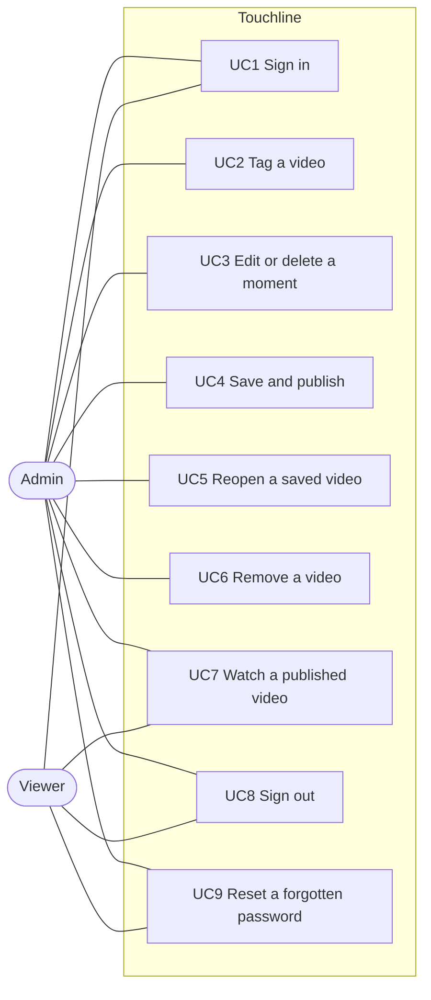

## UC1 Sign in and role routing

Accounts are created in Supabase by the administrator; there is no sign-up
screen. A signed-in account with no row in `app_users` is signed out again.

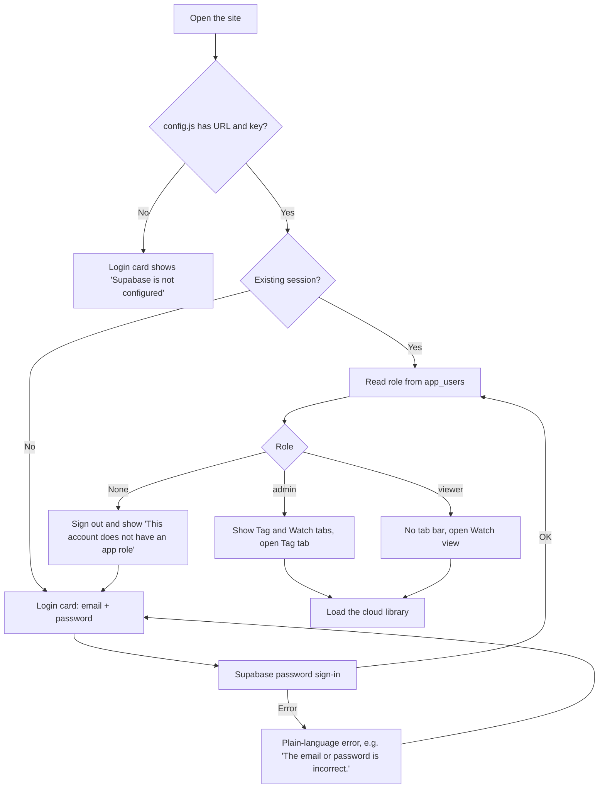

Repeat Supabase events for the same user (token refresh, tab refocus) are
ignored, so they do not reset the tab or reload the library.

## UC2 Tag a video (admin)

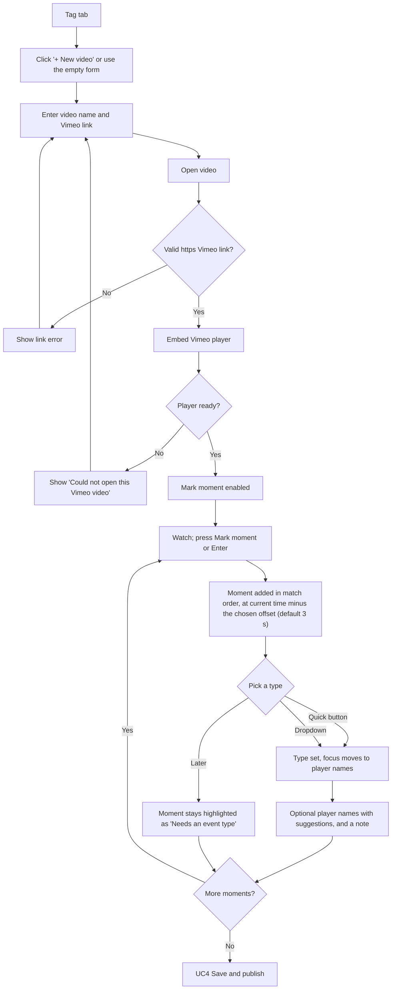

Notes:

- Keyboard: Enter marks, Space plays or pauses, ← and → jump 5 seconds. Keys
  only work while the page has focus, so playback has its own controls under
  the video; clicking inside the Vimeo picture hands the keyboard to Vimeo.
- Full screen (under the video) fills the screen with the video and the
  moments list together. Vimeo's own full screen is disabled in this view
  because it would hide the tagging controls. Hide library widens the video.
- The mark offset (0, 3, 5 or 10 seconds earlier) is remembered in this browser.
- Clicking a moment's timestamp plays the video from that point.
- Player-name suggestions come from names already used in the library.

## Moment lifecycle

There is one list of moments, in match order. A moment is complete as soon as
it has an event type (for "Other", also a custom name). The stored record
keeps a `completed` flag on each moment. Incomplete moments are always saved,
but the Watch view never shows them.

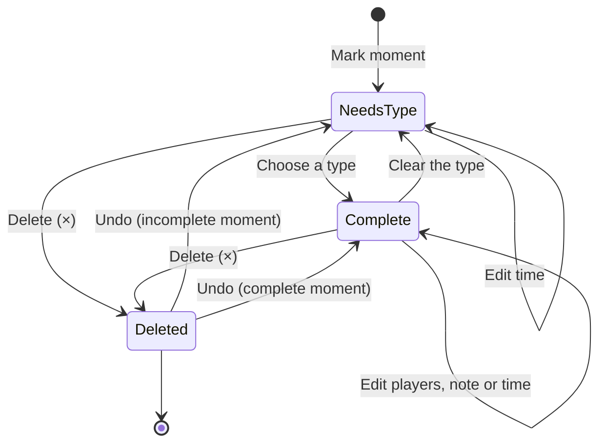

## UC3 Edit or delete a moment (admin)

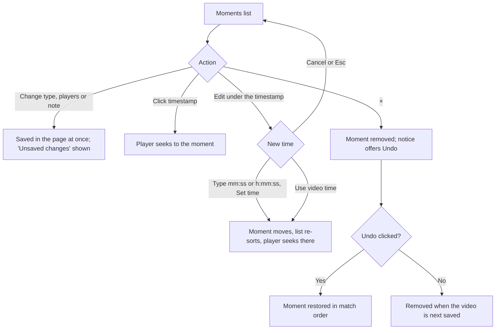

## UC4 Save and publish (admin)

Moments without an event type never block saving or publishing. They are
stored, and the hint under the buttons says how many are hidden from viewers,
for example "2 moments without an event type are saved but hidden from viewers
until they have one."

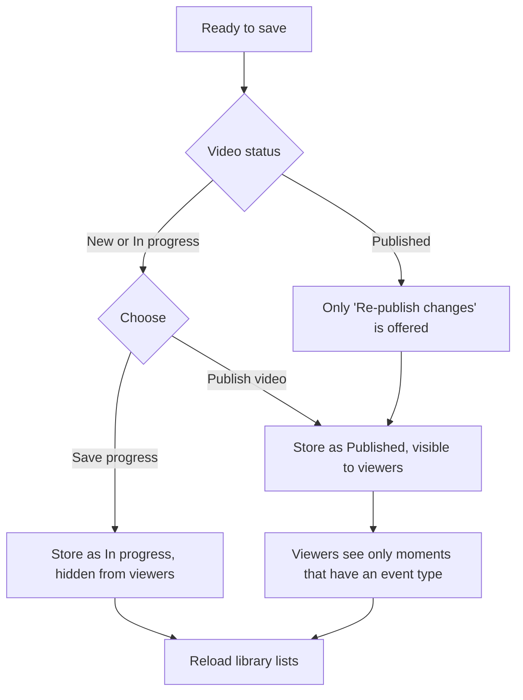

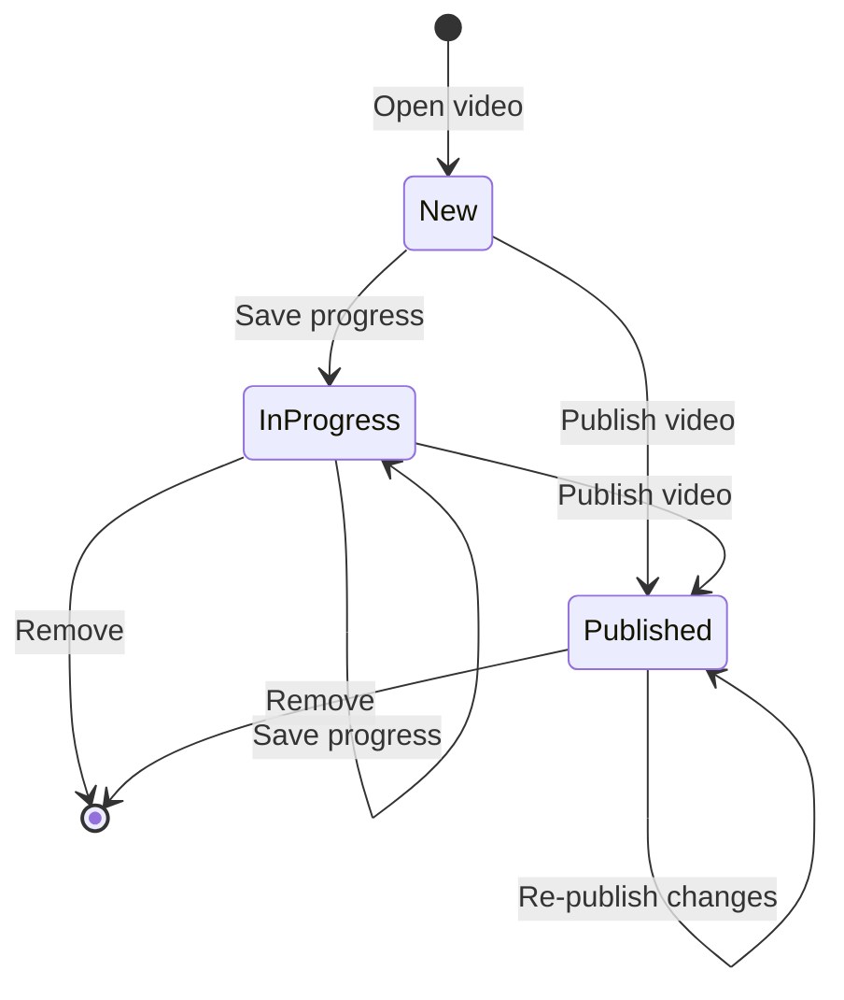

There is currently no way to move a published video back to In progress.

## UC5 Reopen a saved video (admin)

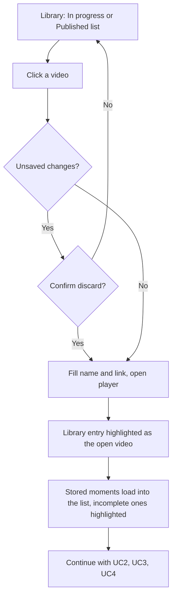

## UC6 Remove a video (admin)

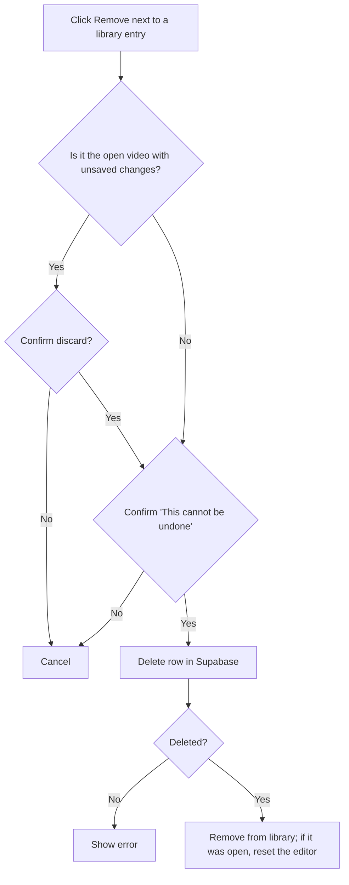

## UC7 Watch a published video (admin or viewer)

Viewers only ever receive published rows; this is enforced by Supabase
row-level security, not only by the UI.

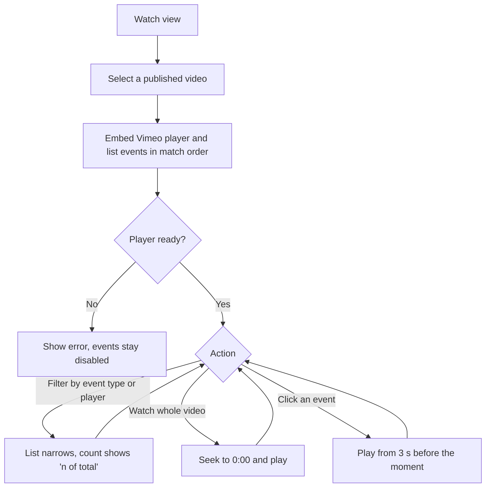

## UC8 Sign out

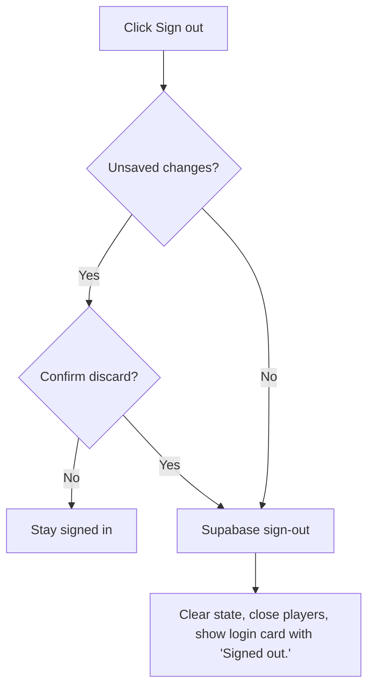

## UC9 Reset a forgotten password

Requires the site URL to be listed under Supabase **Authentication → URL
Configuration → Redirect URLs**.

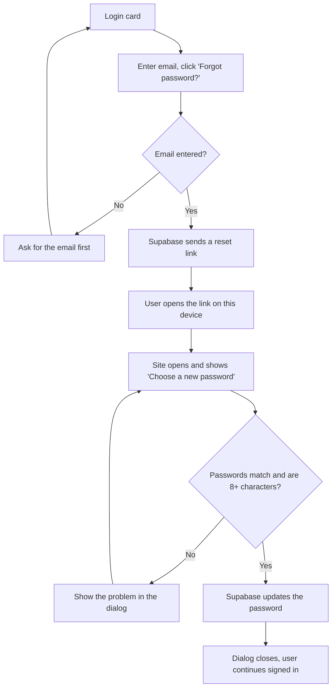
