# Touchline use-case flows

This document describes how people use Touchline, as implemented in
`public/app.js`. Each section has a diagram (Mermaid, rendered by GitHub) and
the rules the UI enforces at each step.

## Actors and use cases

| Actor | Use cases |
| --- | --- |
| Anyone with an account | UC1 Sign in, UC8 Sign out, UC9 Reset a forgotten password |
| Admin | UC2 Tag a video, UC10 Tag a match live, UC3 Edit or delete a moment, UC4 Save and publish, UC5 Reopen a saved video, UC6 Remove a video, UC7 Watch (published only) |
| Viewer | UC7 Watch a published video |
| Supabase | Authenticates users, returns the role, stores videos, enforces row-level security |
| Vimeo | Hosts and plays the video inside an embedded player |

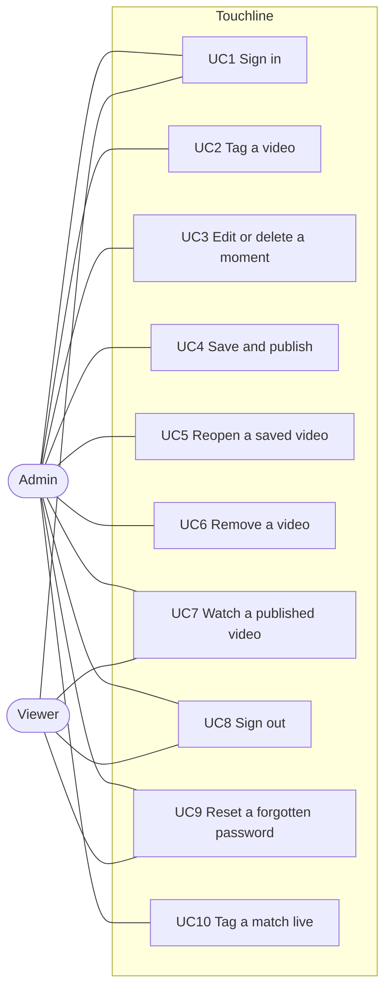

## UC1 Sign in and role routing

Accounts are created in Supabase by the administrator; there is no sign-up
screen. A signed-in account with no row in `app_users` is signed out again.

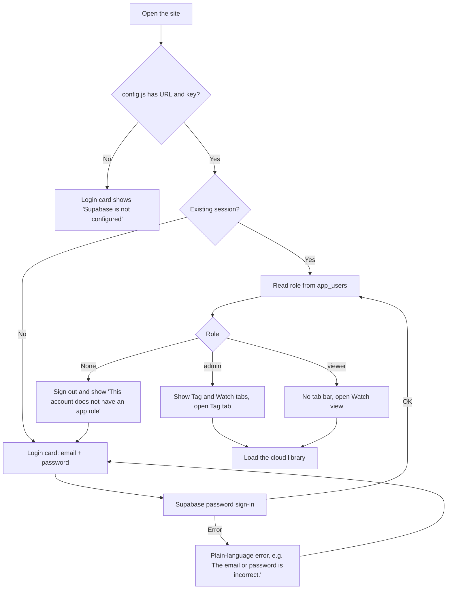

Repeat Supabase events for the same user (token refresh, tab refocus) are
ignored, so they do not reset the tab or reload the library.

## UC2 Tag a video (admin)

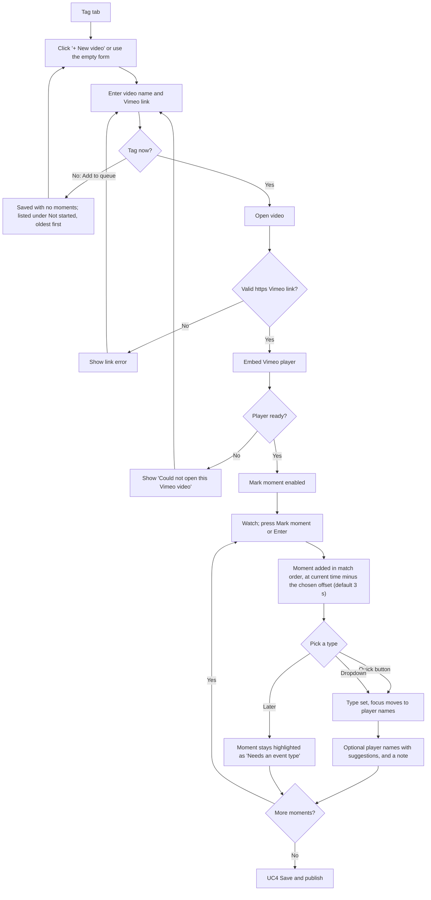

Notes:

- Quick types: letter keys Q W E R T Y (up to U I O, in the order ticked; chosen per device under
  Tagging options) and matching buttons mark a moment with that type in one
  press; it is complete, so it goes straight to Done. Right after any mark,
  Shift + shirt number (added when Shift is released) or number + Enter adds
  that squad player, and Backspace undoes the mark
  (shown in the "Last" bar). An option pauses the video on each mark.
- Review pass: with the video paused, Done moves to the next To do moment and
  seeks there. To do moments can be ticked and edited together (type, player,
  Done, delete).
- When the Vimeo frame takes the keyboard (after a click inside the video), a
  Keys paused bar appears under the video until the page has focus again.
- Keyboard: Enter marks, Space plays or pauses, ← and → jump 5 seconds. Keys
  only work while the page has focus, so playback has its own controls under
  the video; clicking inside the Vimeo picture hands the keyboard to Vimeo.
- Full screen (under the video) fills the screen with the video and the
  moments list together. Vimeo's own full screen is disabled in this view
  because it would hide the tagging controls. Hide library widens the video.
- Zoom (under the video, in Tag and Watch) magnifies the player up to 400%.
  While zoomed, drag pans, the wheel zooms towards the pointer and a click
  plays or pauses; keys + / − / 0 zoom in, out and reset in Tag. It scales the
  Vimeo player box, so close-ups may look soft and Vimeo's controls are hidden.
- The mark offset (0, 3, 5 or 10 seconds earlier) is remembered in this browser.
- Clicking a moment's timestamp plays the video from that point.
- Player-name suggestions come from names already used in the library.

## Tag layout

Once a video is open, its form folds into a heading (team, status, name) with
Edit details. A timeline under the video shows every moment (markers aside):
green done, amber needs a type, white taller for goals, a line at Half-time;
clicking a tick or the bar seeks there. Moments show in **Match order** by
default (time order, split at Half-time) or **To do & Done**; the choice is
remembered per device. Each moment is a one-line summary that opens into the
full editor when clicked (one at a time). Keyboard help sits behind Keys ?.

## Moment lifecycle

Moments are split into a **To do** list (match order) and a **Done** list,
grouped by event type in the order of the event-type list, with custom
"Other" names last. Each group starts folded; click its name to open it. A moment is complete as soon
as it has an event type (for "Other", also a custom name); the admin then
ticks it off with **✓ Done** (or Enter in its player or note field). The
stored record keeps `completed` and `done` flags on each moment. Incomplete
moments are always saved, but the Watch view never shows them. Moments saved
before the Done list existed count as done if they have a type.

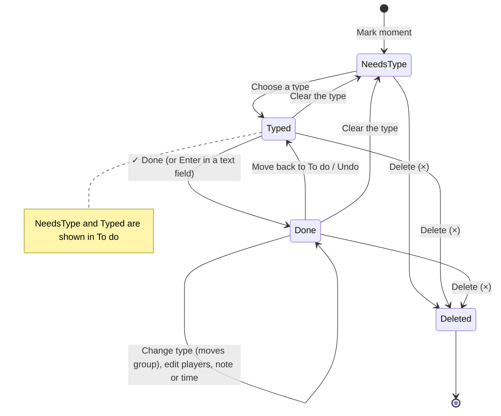

## UC3 Edit or delete a moment (admin)

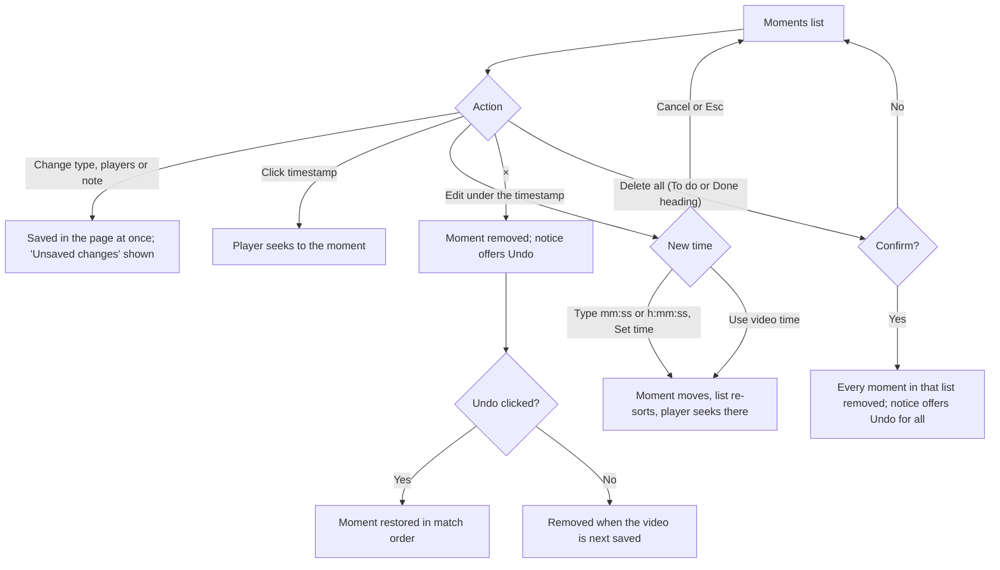

## UC4 Save and publish (admin)

Moments without an event type never block saving or publishing. They are
stored, and the hint under the buttons says how many are hidden from viewers,
for example "2 moments without an event type are saved but hidden from viewers
until they have one."

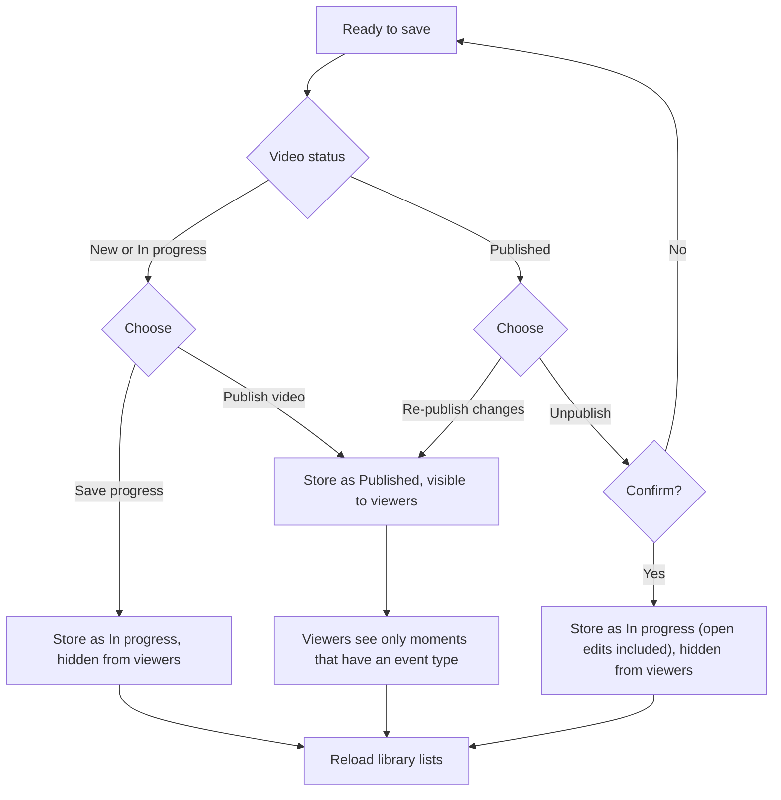

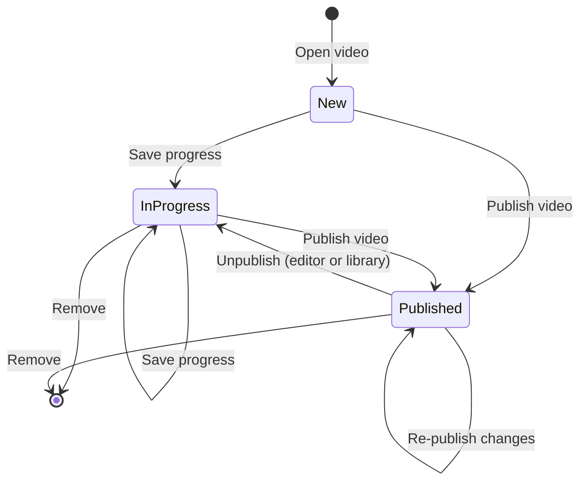

In progress videos autosave a few seconds after each change (at least every
30 seconds while changes keep coming), quietly and without redrawing the list;
opening another video, New video and sign out save pending changes first.
Published videos never autosave. If an autosave fails, the status says so, one
notice appears, and it retries every 30 seconds. Each save replaces the whole
video, so two admins on one video means the last save wins.

A published video can be unpublished from the editor (next to Re-publish
changes) or straight from its Published library entry without opening it.
Either way it asks for confirmation and moves the video back to In progress;
from the editor, any unsaved edits are saved with it.

## UC5 Reopen a saved video (admin)

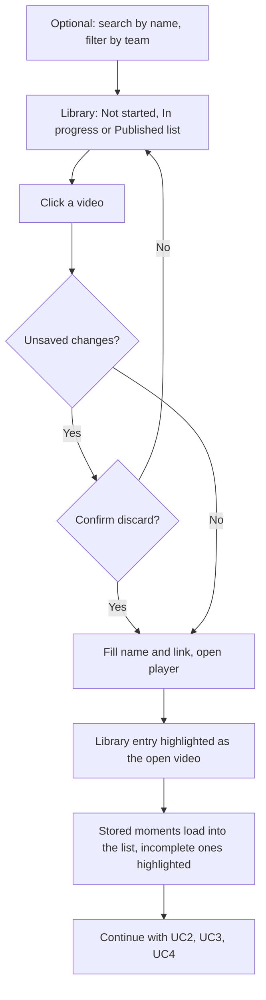

## UC6 Remove a video (admin)

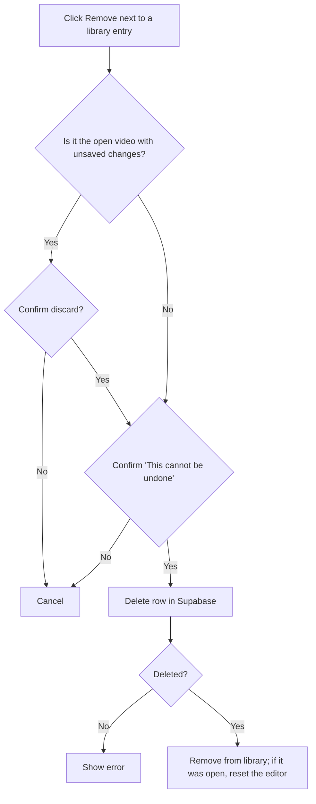

## UC7 Watch a published video (admin or viewer)

Viewers only ever receive published rows; this is enforced by Supabase
row-level security, not only by the UI.

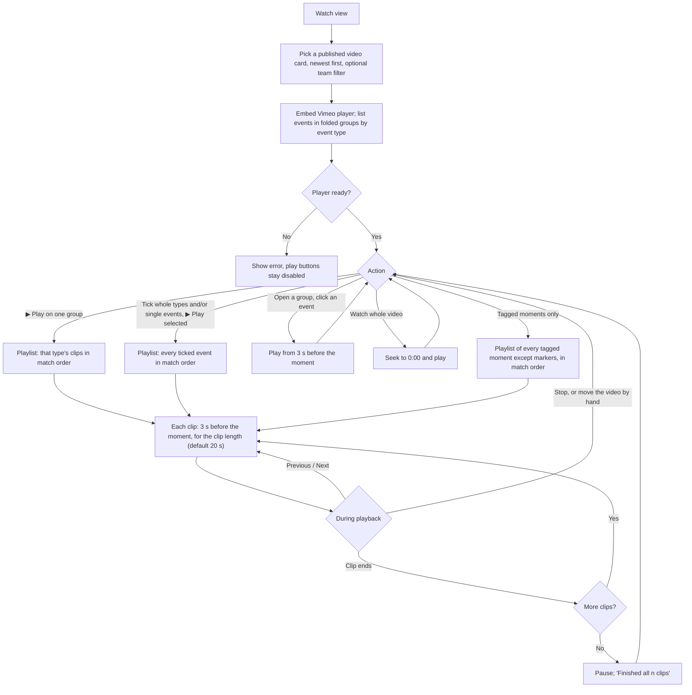

Notes:

- "Tagged moments only" skips the dead time: it plays every event (not
  Start of game, Half-time or End of game) back to back at the current clip
  length, and its button shows the running time, counting overlapping clips once.

- Groups follow the event-type list order (custom types last) and start folded.
- A timeline under the video shows every tagged moment (markers aside; goals
  white, Half-time line). A tick plays that moment (3 s lead); the bar seeks;
  the playing clip's tick is highlighted.
- Tick boxes, Select all, Play selected and Save as playlist only show after
  Choose clips (remembered per device). While choosing, filters by event type
  and by player narrow the list; Select all shown ticks only the matches and
  earlier ticks are kept. Clip length sits above the views and
  applies to Events and Stats. The playlist bar stays in view (pinned to the
  bottom of the screen on phones and tablets) while clips play.
- Every event has its own tick box; a group's tick box selects all its events
  and shows a partly-ticked state (count like `2/8`) when only some are picked.
- Clip length is 5, 10, 15, 20, 30 or 45 seconds, remembered per browser. Changing
  it during a playlist applies from the next clip.
- Overlapping clips run on without jumping back; the playing event is
  highlighted and the playlist bar shows "clip n of total".

### Stats

The **Stats** view (Events | Stats switch in Watch, for admins and viewers)
counts the video's events by type and by player. If a **Half-time** moment
exists, the event table splits into 1st half, 2nd half and total; otherwise it
shows totals only. Start of game, Half-time and End of game are markers and are
never counted. Player names are split on commas and matched ignoring case and
extra spaces; a moment naming two players counts for both. Every count plays
its clips back to back.

New videos (opened new in Tag or added to the queue) get a Start of game moment
at 00:10 automatically, already in Done; it can be moved with Edit. Markers do
not move a video out of Not started.

### Saved playlists

Admins can save the ticked clips as a playlist with a title, an optional note
and the current clip length (needs `database/003_playlists.sql`). Viewers can
read a playlist only while its video is published; this is enforced by
row-level security.

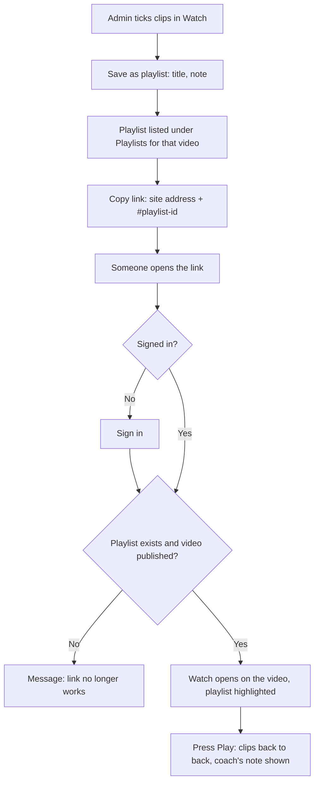

## Teams and squads (admin)

Needs `database/004_teams.sql`. Each video belongs to one team (chosen in the
video form; automatic when there is only one team). The Teams tab lists teams;
for the selected team admins rename it, add, edit and remove players (shirt
number and name) and staff (name and role). Removing keeps the person
(inactive) so old moments and stats still show them; they can be restored.
A team can be deleted, together with its squad, once no videos belong to it;
until then the app explains how many videos to move or remove first.
Viewers can read team names and players, never staff.

When tagging, players are picked from the video's squad as chips; "Other
name…" adds free-text names such as opponents. Typed names that match the
squad become squad players. Moments saved before squads existed are linked to
squad players by name when opened. Stats count squad players by identity and
show their shirt numbers.

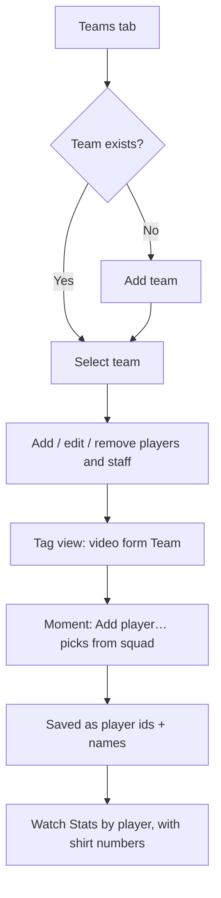

## UC10 Tag a match live (admin)

Live mode is for tagging on the sideline, usually on a phone, before any video
exists. Library → **● Live match** → match name and team → **Start match** on
the kick-off whistle. The camera can start at any time.

- Each tap on a type button saves a moment at the phone's current time
  (`liveAt`, plus `liveHalf` 1 or 2). Its `timestampSeconds` is time since
  kick-off until the video is lined up.
- Shirt-number buttons toggle players on the **last** event only. Tapping the
  next type moves on; the previous event keeps whatever players it had.
- **Moment** saves an untyped moment. **More types…** saves the moment first,
  then opens a searchable list (or "Use …" with your own name for it);
  **Later** leaves it untyped. **Change** and **Undo** act on the last event.
- **Half-time** adds a Half-time marker and stops the clock; **Start 2nd half**
  adds a Kick-off moment marked as the second-half anchor; the clock carries on
  from the first half's length. **End match** adds End of game.
- The match is kept in this browser (`touchline.liveMatch`) first and sent to
  the library a moment later. Without signal it says how many changes are
  waiting and retries; a reload mid-match goes straight back to it. Later sends
  only update name, team and moments, never the Vimeo link.
- The screen is kept awake while a match runs, where the browser allows it.

After the game the match is in the library under **Waiting for video** (no
Vimeo link). Opening it fills in the video form; paste the link and press
**Attach video**. The video opens with the live moments, the link autosaves,
and the **Line up the live moments** card opens under the video:

| Method | Video time of a live moment |
| --- | --- |
| Find kick-off | kick-off time in the video + (moment − kick-off) |
| Kick-off + second-half kick-off | first half as above; second half from the second-half kick-off |
| Clock shown on the video | video time + (moment's time of day − time shown on screen at that video time) |

A nudge of whole seconds applies to all moments. The live times are kept, so
lining up can be redone at any time. Then the match is tagged, reviewed and
published as in UC2–UC4.

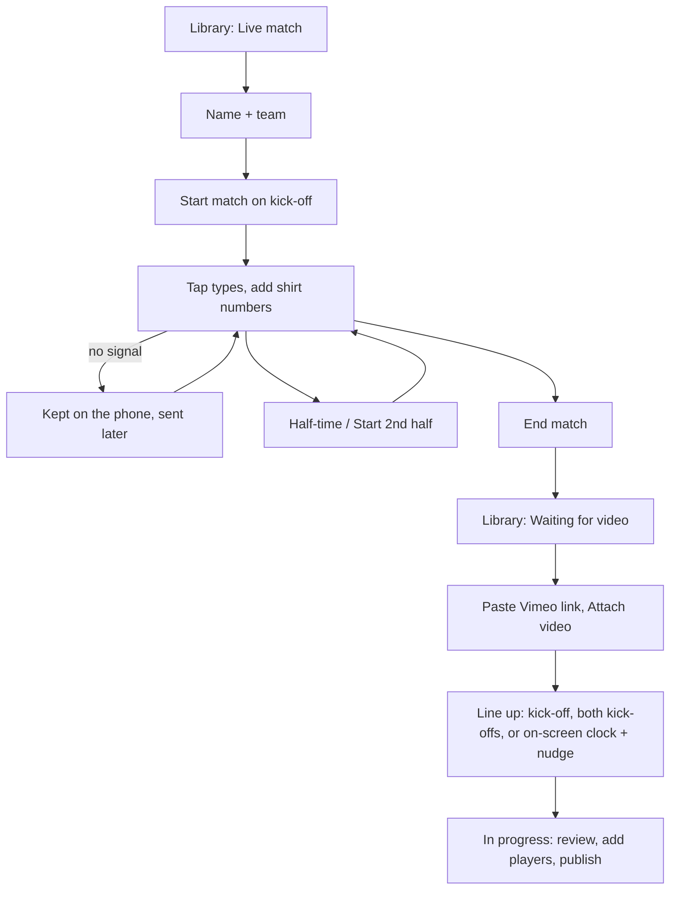

## UC8 Sign out

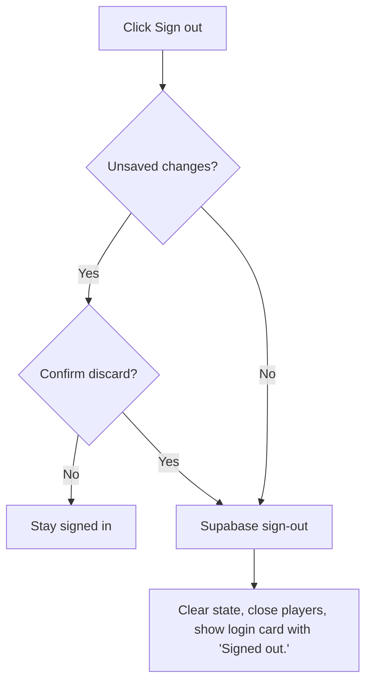

## UC9 Reset a forgotten password

Requires the site URL to be listed under Supabase **Authentication → URL
Configuration → Redirect URLs**.

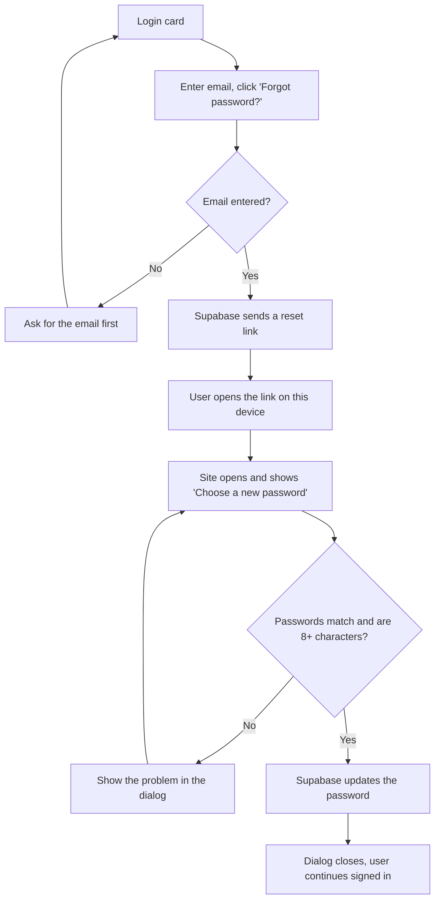
