# Touchline use-case flows

This document describes how people use Touchline, as implemented in
`public/app.js`. Each section has a diagram (Mermaid, rendered by GitHub) and
the rules the UI enforces at each step.

## Actors and use cases

| Actor | Use cases |
| --- | --- |
| Anyone with an account | UC1 Sign in, UC8 Sign out, UC9 Reset a forgotten password |
| Admin | UC2 Tag a video, UC3 Edit or delete a moment, UC4 Save and publish, UC5 Reopen a saved video, UC6 Remove a video, UC7 Watch (published only) |
| Viewer | UC7 Watch a published video |
| Supabase | Authenticates users, returns the role, stores videos, enforces row-level security |
| Vimeo | Hosts and plays the video inside an embedded player |

## UC1 Sign in and role routing

Accounts are created in Supabase by the administrator; there is no sign-up
screen. A signed-in account with no row in `app_users` is signed out again.

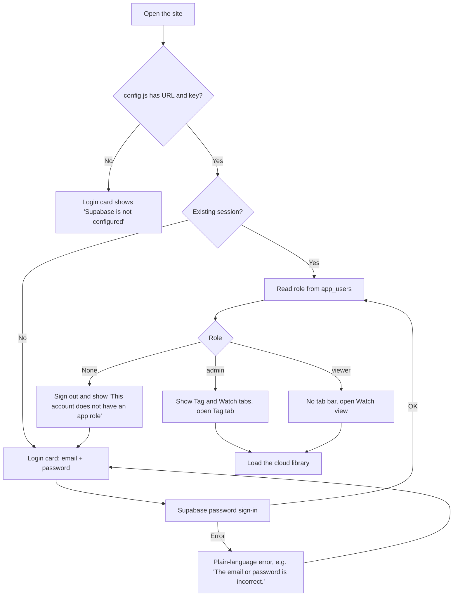

Repeat Supabase events for the same user (token refresh, tab refocus) are
ignored, so they do not reset the tab or reload the library.

## UC2 Tag a video (admin)

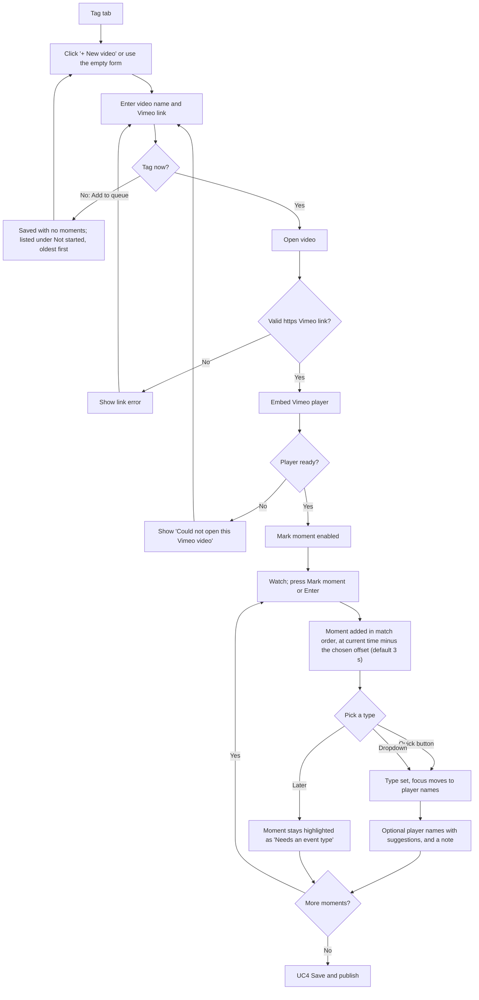

Notes:

- Quick types: letter keys Q W E R T Y (up to U I O, in the order ticked; chosen per device under
  Tagging options) and matching buttons mark a moment with that type in one
  press; it is complete, so it goes straight to Done. Right after any mark,
  Shift + shirt number (added when Shift is released) or number + Enter adds
  that squad player, and Backspace undoes the mark
  (shown in the "Last" bar). An option pauses the video on each mark.
- Review pass: with the video paused, Done moves to the next To do moment and
  seeks there. To do moments can be ticked and edited together (type, player,
  Done, delete).
- Keyboard: Enter marks, Space plays or pauses, ← and → jump 5 seconds. Keys
  only work while the page has focus, so playback has its own controls under
  the video; clicking inside the Vimeo picture hands the keyboard to Vimeo.
- Full screen (under the video) fills the screen with the video and the
  moments list together. Vimeo's own full screen is disabled in this view
  because it would hide the tagging controls. Hide library widens the video.
- Zoom (under the video, in Tag and Watch) magnifies the player up to 400%.
  While zoomed, drag pans, the wheel zooms towards the pointer and a click
  plays or pauses; keys + / − / 0 zoom in, out and reset in Tag. It scales the
  Vimeo player box, so close-ups may look soft and Vimeo's controls are hidden.
- The mark offset (0, 3, 5 or 10 seconds earlier) is remembered in this browser.
- Clicking a moment's timestamp plays the video from that point.
- Player-name suggestions come from names already used in the library.

## Moment lifecycle

Moments are split into a **To do** list (match order) and a **Done** list,
grouped by event type in the order of the event-type list, with custom
"Other" names last. Each group starts folded; click its name to open it. A moment is complete as soon
as it has an event type (for "Other", also a custom name); the admin then
ticks it off with **✓ Done** (or Enter in its player or note field). The
stored record keeps `completed` and `done` flags on each moment. Incomplete
moments are always saved, but the Watch view never shows them. Moments saved
before the Done list existed count as done if they have a type.

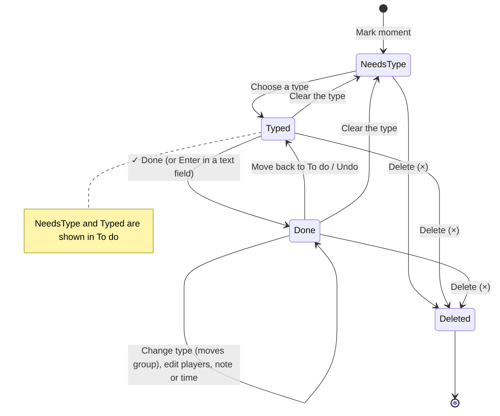

## UC3 Edit or delete a moment (admin)

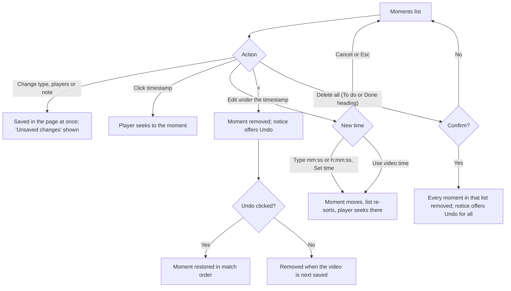

## UC4 Save and publish (admin)

Moments without an event type never block saving or publishing. They are
stored, and the hint under the buttons says how many are hidden from viewers,
for example "2 moments without an event type are saved but hidden from viewers
until they have one."

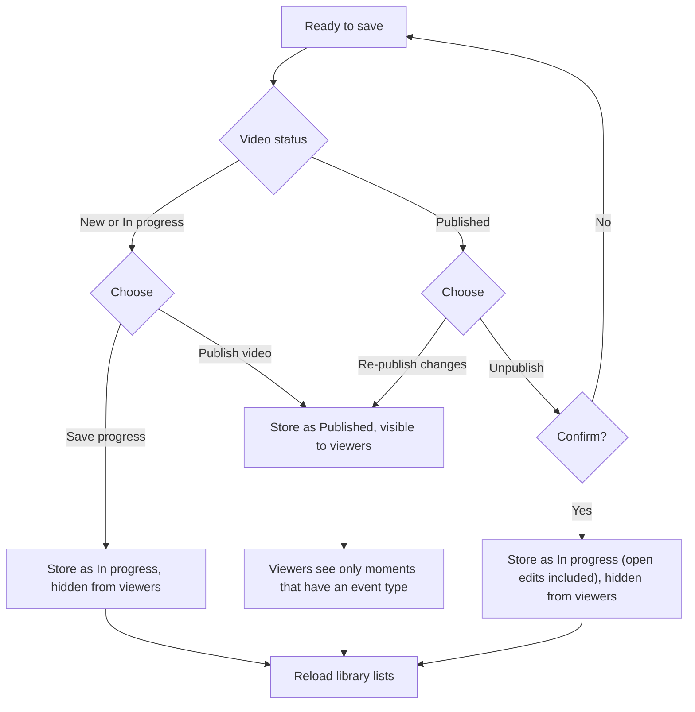

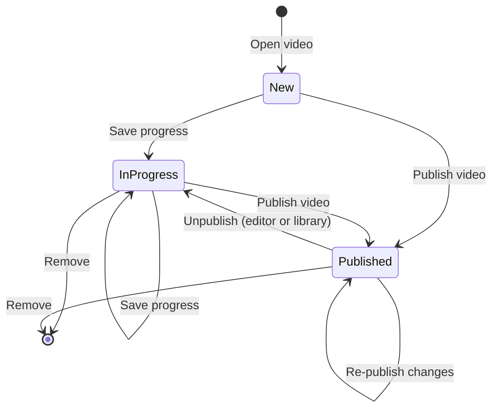

A published video can be unpublished from the editor (next to Re-publish
changes) or straight from its Published library entry without opening it.
Either way it asks for confirmation and moves the video back to In progress;
from the editor, any unsaved edits are saved with it.

## UC5 Reopen a saved video (admin)

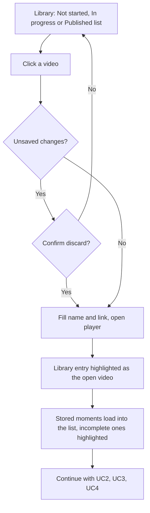

## UC6 Remove a video (admin)

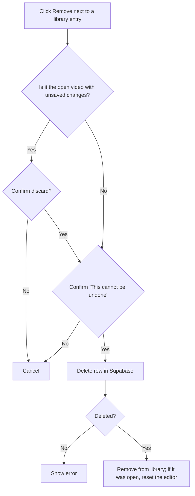

## UC7 Watch a published video (admin or viewer)

Viewers only ever receive published rows; this is enforced by Supabase
row-level security, not only by the UI.

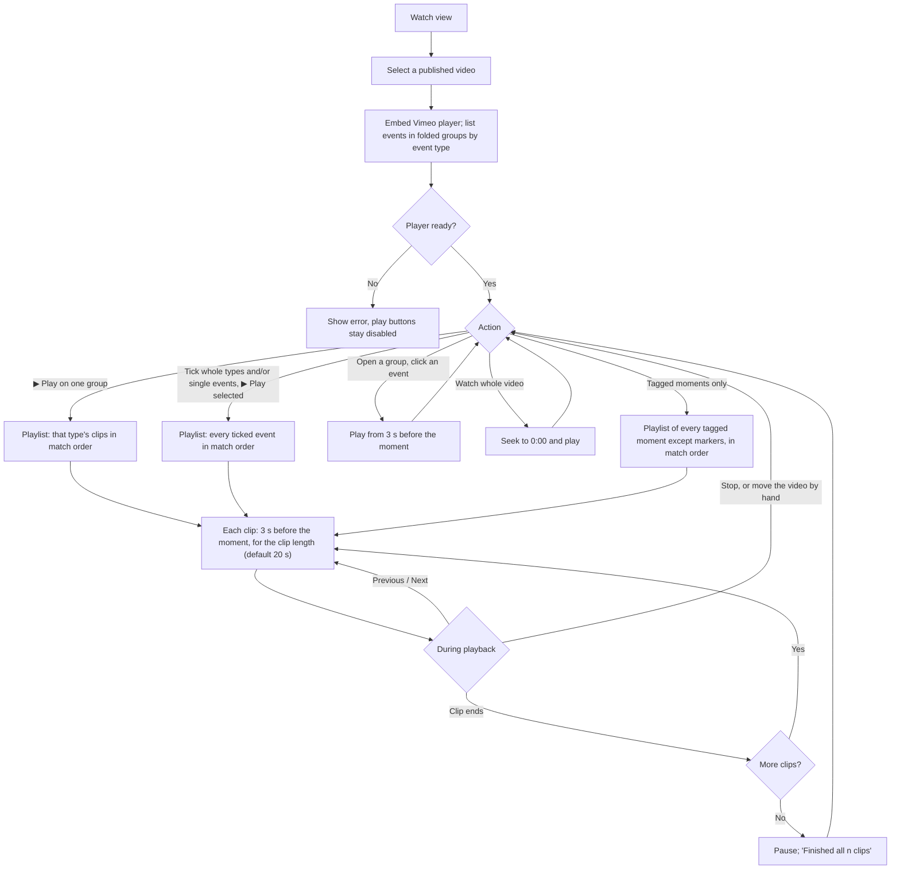

Notes:

- "Tagged moments only" skips the dead time: it plays every event (not
  Start of game, Half-time or End of game) back to back at the current clip
  length, and its button shows the running time, counting overlapping clips once.

- Groups follow the event-type list order (custom types last) and start folded.
- Every event has its own tick box; a group's tick box selects all its events
  and shows a partly-ticked state (count like `2/8`) when only some are picked.
- Clip length is 5, 10, 15, 20, 30 or 45 seconds, remembered per browser. Changing
  it during a playlist applies from the next clip.
- Overlapping clips run on without jumping back; the playing event is
  highlighted and the playlist bar shows "clip n of total".

### Stats

The **Stats** view (Events | Stats switch in Watch, for admins and viewers)
counts the video's events by type and by player. If a **Half-time** moment
exists, the event table splits into 1st half, 2nd half and total; otherwise it
shows totals only. Start of game, Half-time and End of game are markers and are
never counted. Player names are split on commas and matched ignoring case and
extra spaces; a moment naming two players counts for both. Every count plays
its clips back to back.

New videos (opened new in Tag or added to the queue) get a Start of game moment
at 00:10 automatically, already in Done; it can be moved with Edit. Markers do
not move a video out of Not started.

### Saved playlists

Admins can save the ticked clips as a playlist with a title, an optional note
and the current clip length (needs `database/003_playlists.sql`). Viewers can
read a playlist only while its video is published; this is enforced by
row-level security.

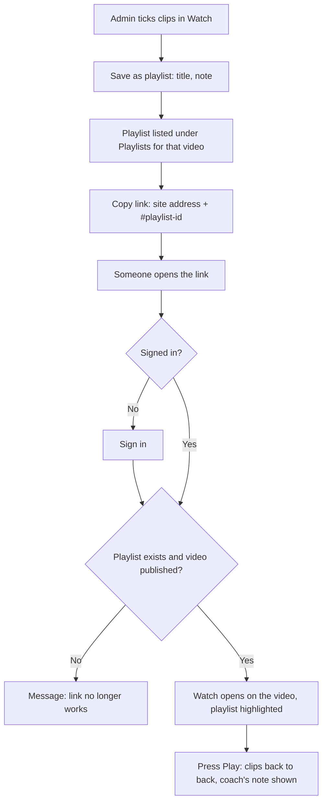

## Teams and squads (admin)

Needs `database/004_teams.sql`. Each video belongs to one team (chosen in the
video form; automatic when there is only one team). The Teams tab lists teams;
for the selected team admins rename it, add, edit and remove players (shirt
number and name) and staff (name and role). Removing keeps the person
(inactive) so old moments and stats still show them; they can be restored.
A team can be deleted, together with its squad, once no videos belong to it;
until then the app explains how many videos to move or remove first.
Viewers can read team names and players, never staff.

When tagging, players are picked from the video's squad as chips; "Other
name…" adds free-text names such as opponents. Typed names that match the
squad become squad players. Moments saved before squads existed are linked to
squad players by name when opened. Stats count squad players by identity and
show their shirt numbers.

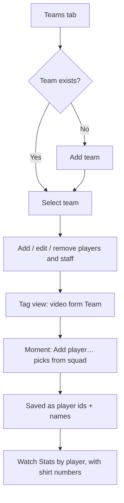

## UC8 Sign out

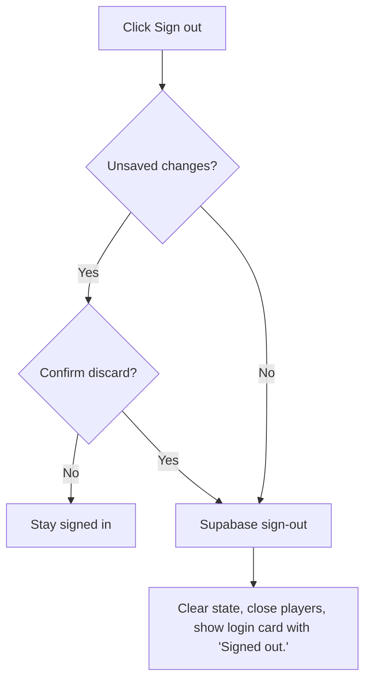

## UC9 Reset a forgotten password

Requires the site URL to be listed under Supabase **Authentication → URL
Configuration → Redirect URLs**.

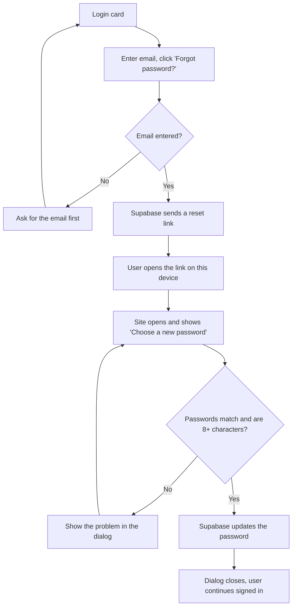
